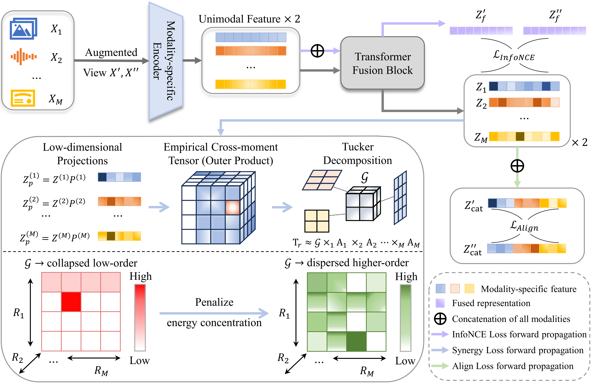

<h1 align="center">
  HRIL: Learning Multimodal Synergy <br>via Higher-Order Tensor Modeling
</h1>

<p align="center">
  <strong>Qun Dai, Liangjian Wen, Jiang Duan, Yong Dai, Dongkai Wang,<br>
  Maolin Wang, Mingjie Wang, Jianzhuang Liu, HE YAN, Zhao Kang</strong>
</p>

<p align="center">
  <a href="https://neurips.cc/virtual/2026/loc/sydney/poster/151076"></a>
  <a href="https://arxiv.org/abs/2610.12393"></a>
  <a href="https://pytorch.org/"></a>
</p>

<p align="center">
  Official PyTorch implementation of <strong>HRIL</strong>, accepted at <strong>NeurIPS 2026</strong>.
</p>

<p align="center">
  <a href="#tldr">TL;DR</a> &nbsp;·&nbsp;
  <a href="#key-results">Key Results</a> &nbsp;·&nbsp;
  <a href="#our-approach">Our Approach</a> &nbsp;·&nbsp;
  <a href="#quick-start">Quick Start</a> &nbsp;·&nbsp;
  <a href="#citation">Citation</a> &nbsp;·&nbsp;
  <a href="#acknowledgments">Acknowledgments</a>
</p>

---

<a id="tldr"></a>

## 🎯 TL;DR
<p align="center">
  
  <em>HRIL combines modality-fusion alignment with explicit higher-order dependence modeling.</em>
</p>

> **Synergy is information that emerges only when modalities are observed jointly.**

HRIL (**Higher-order Representation and Information Learning**) explicitly models cross-modal dependence to preserve the representational capacity needed for such information.

- ✅ **Beyond pairwise alignment:** our analysis shows that minimal sufficient pairwise contrastive representations can discard pure synergy when there are more than two modalities.
- ✅ **Explicit multi-way interactions:** empirical cross-moment tensors and Tucker decomposition provide a compact interaction core.
- ✅ **Synergy-aware regularization:** discouraging excessive core-energy concentration preserves capacity for higher-order coupling.
- ✅ **Consistent empirical gains:** improved synergy and uniqueness on Trifeature, and higher linear probing accuracy across the reported bimodal and trimodal MultiBench tasks.

<a id="key-results"></a>

## 📊 Key Results

### Controlled Synergy · Trifeature

The probes measure redundancy (shared shape), uniqueness (modality-specific texture), and synergy (a cross-modal color-texture relationship). Chance accuracy is 10% for redundancy and uniqueness, and 50% for synergy.

| Method | Redundancy | Uniqueness | Synergy |
| :--- | ---: | ---: | ---: |
| Cross | **100.0** | 11.6 | 50.0 |
| Cross+Self | 99.7 | 86.9 | 50.0 |
| FactorCL | 99.8 | 62.5 | 46.5 |
| CoMM | 99.9 &plusmn; 0.06 | 86.8 &plusmn; 2.99 | 71.4 &plusmn; 3.47 |
| **HRIL (ours)** | 99.7 &plusmn; 0.14 | **92.6 &plusmn; 3.04** | **82.3 &plusmn; 1.61** |


### Three Modalities · MultiBench

Linear probing top-1 classification accuracy with three modalities.

| Method | UR-FUNNY | MOSI | MOSEI | Average |
| :--- | ---: | ---: | ---: | ---: |
| Tri_CLIP | 60.6 &plusmn; 0.79 | 60.1 &plusmn; 3.43 | 64.1 &plusmn; 0.42 | 61.6 |
| CMC | 60.1 &plusmn; 0.78 | 62.4 &plusmn; 1.67 | 62.7 &plusmn; 0.72 | 61.73 |
| ConFu | 61.3 &plusmn; 0.96 | 62.5 &plusmn; 2.66 | 64.8 &plusmn; 0.61 | 62.87 |
| CoMM | 64.8 &plusmn; 1.13 | 66.0 &plusmn; 2.27 | 69.9 &plusmn; 0.34 | 66.9 |
| **HRIL (ours)** | **65.5 &plusmn; 0.56** | **67.2 &plusmn; 1.28** | **70.5 &plusmn; 0.20** | **67.73** |

### Two Modalities · MultiBench

Linear probing top-1 classification accuracy with two modalities.

| Method | MIMIC | MOSI | UR-FUNNY | MUSTARD | Average |
| :--- | ---: | ---: | ---: | ---: | ---: |
| Cross | 66.7 &plusmn; 0.1 | 47.8 &plusmn; 1.8 | 50.1 &plusmn; 1.9 | 53.5 &plusmn; 2.9 | 54.52 |
| Cross+Self | 65.49 &plusmn; 0.0 | 49.0 &plusmn; 1.1 | 59.9 &plusmn; 0.9 | 53.9 &plusmn; 4.0 | 57.07 |
| FactorCL | 67.3 &plusmn; 0.0 | 51.2 &plusmn; 1.6 | 60.5 &plusmn; 0.8 | 55.80 &plusmn; 0.9 | 58.7 |
| CoMM | 66.4 &plusmn; 0.4 | 63.7 &plusmn; 2.5 | 63.3 &plusmn; 0.5 | 64.4 &plusmn; 1.1 | 64.45 |
| **HRIL (ours)** | **68.0 &plusmn; 0.7** | **65.8 &plusmn; 1.2** | **63.9 &plusmn; 0.9** | **66.6 &plusmn; 2.7** | **66.08** |

## 💡 Why Higher-Order Dependence?

Pairwise alignment primarily rewards information shared between modalities. Under the assumptions in our analysis, a representation that is sufficient for all pairwise alignments but minimal in information content can omit pure synergy accessible only through the joint observation of all modalities.

HRIL connects pure synergistic information to a conditional total-correlation difference. This motivates explicitly modeling multi-way dependence rather than relying on pairwise alignment alone. The practical regularizer preserves capacity for these interactions.

<a id="our-approach"></a>

## 🧩 Our Approach

### From Modality Views to Joint Representations

1. **Encode and fuse.** Construct two augmented views, encode each modality, and use a shared Transformer to produce unimodal and fused representations.
2. **Model joint dependence.** Project unimodal embeddings into lower-dimensional subspaces, construct an empirical cross-moment tensor for each view, and apply Tucker decomposition.
3. **Preserve interaction capacity.** Apply a synergy-aware margin penalty to discourage excessive energy concentration in the Tucker cores.
4. **Learn stable representations.** Combine modality-fusion InfoNCE with cross-view invariance and variance regularization.

### Training Objective

$$
\mathcal{L}_{\mathrm{total}} = \sum_{m=1}^{M}\mathcal{L}_{\mathrm{InfoNCE}}^{(m)} + \lambda_a\mathcal{L}_{\mathrm{align}} + \lambda_s\mathcal{L}_{\mathrm{syn}}.
$$

<a id="quick-start"></a>

## 🚀 Quick Start

### 1. Installation

Clone this repository, then create the environment specified in [`environment.yml`](environment.yml).

```bash
git clone https://github.com/brightest66/HRIL.git
cd HRIL
conda env create -f environment.yml
conda activate hril
```

> **Dataset setup:** set the dataset paths in [`dataset/catalog.json`](dataset/catalog.json) before running the experiments.

### 2. Training

**Trifeature · Controlled synthetic experiments**

```bash
bash run_scripts/trifeatures_run.sh
```

**MultiBench · Two modalities**

```bash
bash run_scripts/multibench_run.sh
```

**MultiBench · Three modalities**

```bash
bash run_scripts/tri-mod_run.sh
```

**Multimodal IMDb · Two modalities**

```bash
bash run_scripts/MM_IMDb_run.sh
```

### 3. Evaluation

To evaluate the learned representations, update [`run_scripts/test.sh`](run_scripts/test.sh) to match the training run:

| Setting | What to configure |
| :--- | :--- |
| Entry point | The training entry point for the experiment |
| Dataset parameters | The dataset and parameters used for training |
| Checkpoint path | The checkpoint to evaluate |

```bash
bash run_scripts/test.sh
```

<a id="citation"></a>

## 📝 Citation

If you find this work useful, please cite:

```bibtex
@inproceedings{dai2026hril,
  title={HRIL: Learning Multimodal Synergy via Higher-Order Tensor Modeling},
  author={Dai, Qun and Wen, Liangjian and Duan, Jiang and Dai, Yong and
          Wang, Dongkai and Wang, Maolin and Wang, Mingjie and Liu, Jianzhuang and
          Yan, He and Kang, Zhao},
  booktitle={Advances in Neural Information Processing Systems},
  year={2026},
  url={https://arxiv.org/pdf/2610.12393}
}
```

<a id="acknowledgments"></a>

## 🙏 Acknowledgments

This codebase builds upon [CoMM](https://github.com/Duplums/CoMM). The implementation of InterSHAP for evaluating cross-modal interactions is available in [InterSHAP](https://github.com/LauraWenderoth/InterSHAP). We thank the authors for their excellent implementations.


<p align="center">
  <a href="#top">↑ Back to top</a>
</p>
